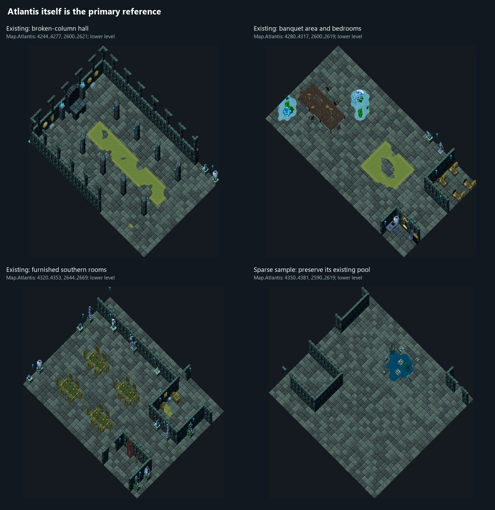
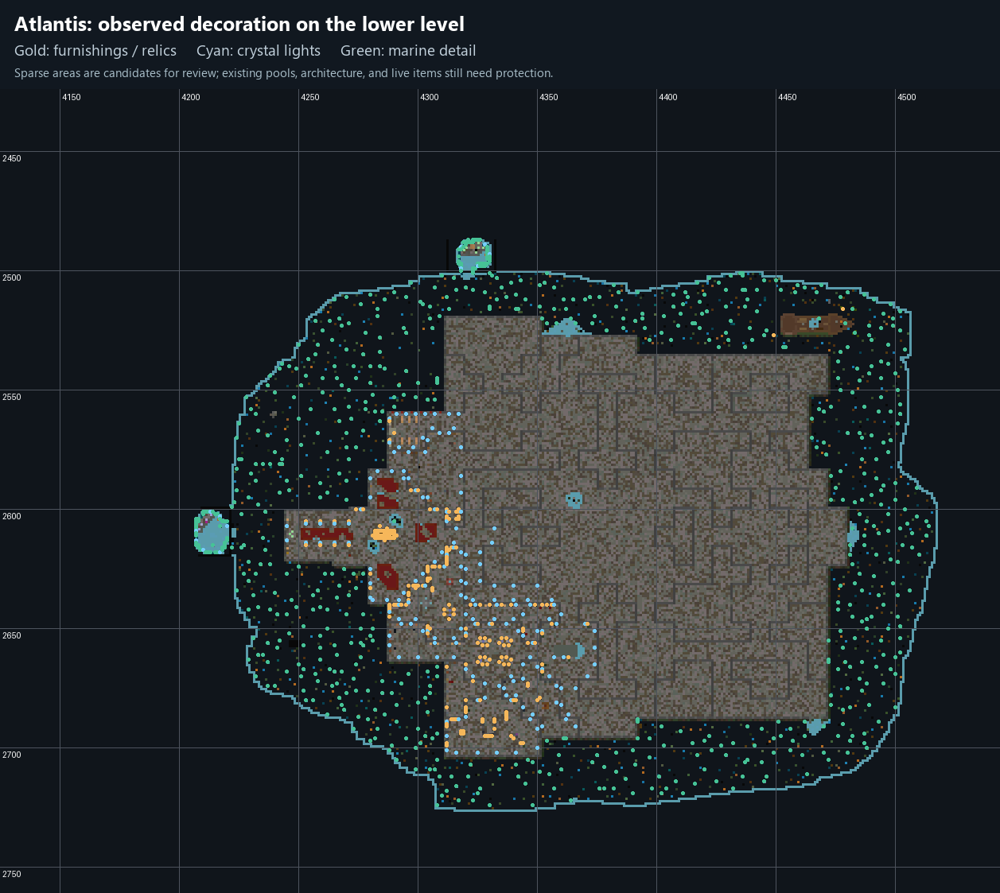
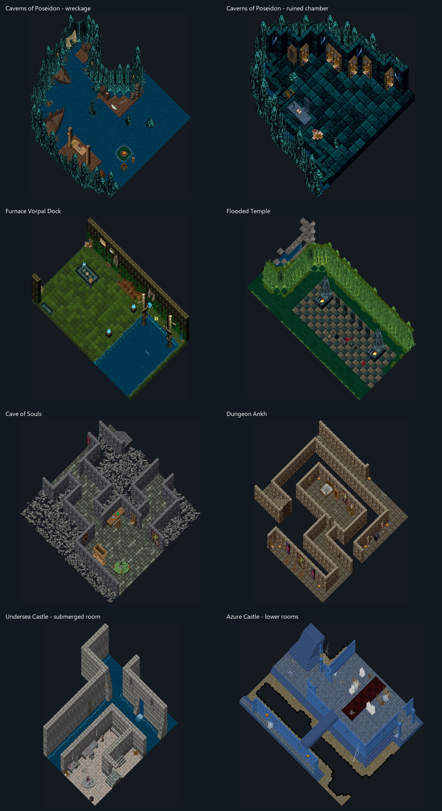
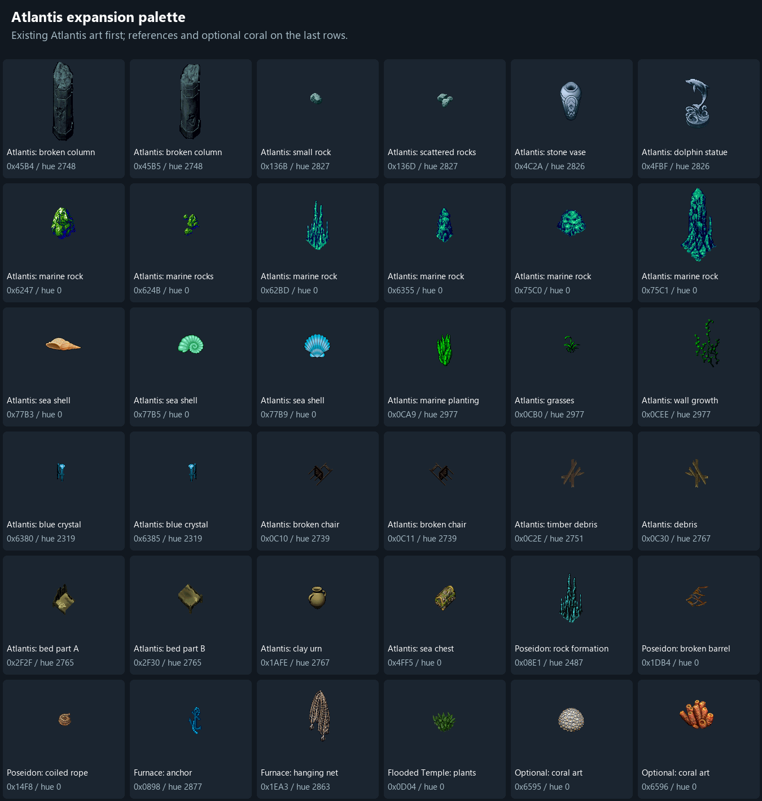
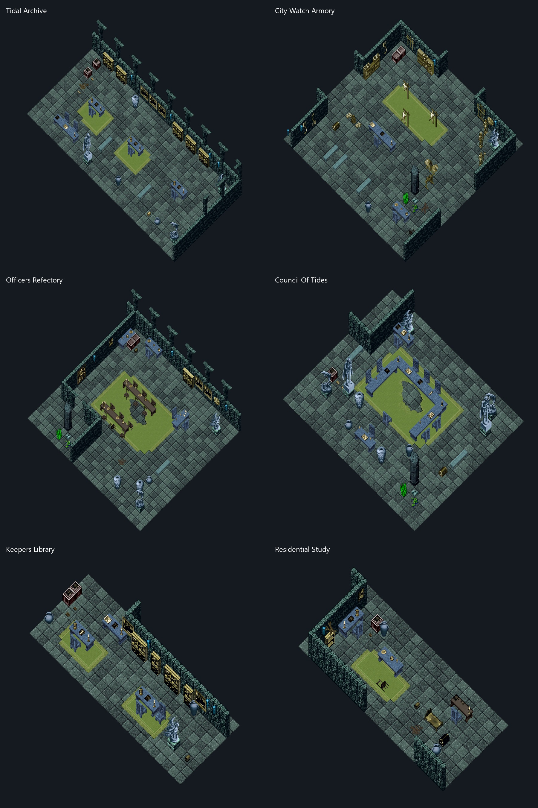

# Atlantis decoration expansion study

The direction is a ruined underwater city, continuing the decoration already present in Atlantis. Its finished rooms are the primary reference. The seven requested locations supply additional arrangements and details. Monsters are a later task.

The result is an additive preview of immovable world items. The [implemented preview commands](preview-commands.md) place 1,356 items in 13 furnished rooms across four sparse districts. This study records the references behind those additions.

Atlantis already has a broken-column hall with a damaged carpet, a partly ruined banquet table, bedrooms, furnished southern rooms, statues and vases on pedestals, blue crystal lights, and marine pools. Those arrangements establish the local style and should remain intact.

The lower-level survey shows furnished clusters in the west and south-central interior, with substantially sparser rooms to the north and east. Marine detail also surrounds much of the city. Even the sparse sample contains an existing pool, so a low decoration count is only a cue for room-by-room inspection.

The survey marks selected existing statics, not every object. It does not include live world items or prove that an unmarked tile is available for placement.

| Existing Atlantis sample | X range | Y range | Details to continue |
| --- | --- | --- | --- |
| Broken-column hall | 4244–4277 | 2600–2621 | Damaged columns, gaps in carpet, pale ornaments, blue lights |
| Banquet area and bedrooms | 4280–4317 | 2600–2619 | Broken furniture, table settings, marine pools, sea chests |
| Furnished southern rooms | 4320–4353 | 2644–2669 | Stone furniture, restrained statue displays, existing room functions |
| Sparse interior sample | 4350–4381 | 2590–2619 | Room-scale expansion opportunity around a pool that must be preserved |

These samples use the lower level, with static bases between Z −128 and −91. Atlantis's registered region spans X 4125–4543 and Y 2424–2760. It is `Map.Atlantis`, logical map index 6, backed by file index 1. The substantial layer at Z −87 and the water above must be distinguished from the lower floor around Z −127.

| Reference | Observed decoration approach | Application to Atlantis |
| --- | --- | --- |
| Caverns of Poseidon | Blue-green stalagmite and flowstone borders; wrecked boats, broken barrels, nets, and furnished cave chambers | Let marine formations collect at edges and around damage; give selected rooms a former civic or domestic purpose |
| Furnace Vorpal Dock | Marine growth along the wall, shells, hanging nets, ropes, anchors, and crystal accents; open central space | Use compact maritime arrangements near appropriate water-facing rooms and transitions |
| Flooded Temple | Surviving masonry and statues within dense green formations and water; fragmentary paved areas | Make surviving ornaments feel overtaken by marine growth; use the arrangement while matching Atlantis's existing colors |
| Cave of Souls | Dense bone-covered surroundings, a repeated hue treatment, and comparatively readable furnished chambers | Borrow the contrast between crowded edges and readable room interiors; extensive bones would change Atlantis's emphasis |
| Dungeon Ankh | Broken chairs, damaged beds and dressers, wall furnishings, and sparse floor detail in identifiable rooms | Extend Atlantis's existing damaged furnishings into rooms that still suggest their original use |
| Undersea Castle | Water around surviving castle rooms, stone tables and benches, statues, seaweed, and localized debris | Retain the sense of a once-inhabited city through stone furniture and small relic arrangements |
| Azure Castle | Consistent blue architecture, pale statues, contrasting carpets, and localized damage | Continue Atlantis's own coherent palette and use a small number of focal ornaments |

The rendered reference samples are at these locations:

| Reference sample | Logical map | X range | Y range | Rendered Z interval |
| --- | --- | --- | --- | --- |
| Poseidon wreckage | Sosaria | 5258–5281 | 2098–2121 | −5 ≤ Z < 30 |
| Poseidon chamber | Sosaria | 5218–5241 | 1958–1981 | −5 ≤ Z < 30 |
| Furnace dock | SerpentIsland | 1965–1996 | 1738–1763 | −5 ≤ Z < 35 |
| Flooded Temple | SerpentIsland | 2458–2487 | 821–847 | −5 ≤ Z < 30 |
| Cave of Souls | SerpentIsland | 2480–2503 | 176–199 | −5 ≤ Z < 8 |
| Dungeon Ankh | SerpentIsland | 2040–2063 | 180–203 | −5 ≤ Z < 25 |
| Undersea Castle | SavagedEmpire | 620–643 | 4036–4059 | −6 ≤ Z < 20 |
| Azure Castle | SavagedEmpire | 220–249 | 3619–3642 | −1 ≤ Z < 25 |

The [palette manifest](art-palette.json) records 36 candidate artwork/hue combinations, their tiledata heights and impassable flags, and an existing Atlantis coordinate where that exact combination was found. The first 28 combinations come from Atlantis itself. The next six come from the requested references; the last two are supplemental coral graphics available in the client, not observed in the surveyed Atlantis statics.

| Use | Existing Atlantis artwork | Hue |
| --- | --- | --- |
| Damaged masonry | Broken columns `0x45B4`, `0x45B5` | 2748 |
| Small stone fragments | Rocks `0x136B`, `0x136D` | 2827 |
| Civic ornaments | Stone vase `0x4C2A`, dolphin statue `0x4FBF` | 2826 |
| Marine formations | `0x6247`, `0x624B`, `0x62BD`, `0x6355`, `0x75C0`, `0x75C1` | 0 |
| Shells | `0x77B3`, `0x77B5`, `0x77B9` | 0 |
| Planting and wall growth | `0x0CA9`, `0x0CB0`, `0x0CEE` | 2977 |
| Blue crystal fixtures | `0x6380`, `0x6385` | 2319 |
| Broken chairs | `0x0C10`, `0x0C11` | 2739 |
| Paired damaged bed pieces | `0x2F2F`, `0x2F30` | 2765 |

Tiledata labels are only a starting point. Many of Atlantis's colorful marine formations are named “rock”; the `debris` graphics inspected here are timber, not broken masonry. The palette was visually checked against the actual client artwork.

The first preview overused exterior marine props and did not carry these interior arrangements through into the new rooms. The revised [furnished-room preview](preview-commands.md) uses the specific Atlantis rooms at **4304,2579** and **4287,2617** as its primary models: complete weapon displays, bookcases, framed wall art, blue stone desks and chairs, raised table settings, pedestals, and broken banquet tables. The density revision adds furnishings to every proposed room and separates the two civic table designs: a U-shaped stone council table and two narrow wooden tables in the officers' refectory. Torn carpet edges reuse the cave-floor artwork already used in Atlantis's rugs. Coral appears only beside four masonry ruins, and there are no new shells.

The earlier palette image above documents the material survey; it is not the complete interior furniture palette. The [interior asset inventory](interior-assets-v2.json) records every art/hue pair in the revised manifest and an existing Atlantis example when found.

Review the complete footprint of each arrangement against existing statics and live items, including art that extends beyond its anchor tile. Preserve furnished clusters, pools, lights, doors, stairs, portals, and the clear routes through them. Many marine sprites are impassable according to tiledata; `Movable = false` prevents pickup but does not make them passable.

The preview command creates items only on `Map.Atlantis`, tracks its own additions, prevents duplicate application, and removes only its own items when cleared. It rechecks proposed placements against the current world. Existing decoration is preserved, and a global world-decoration rebuild is unnecessary for this preview.

The inspection used the server's map/statics and tiledata together with the downloaded Memento client's art and hues. Images are offline reference renders with selected upper layers hidden; live world items, animation, terrain slope rendering, and client lighting are not reproduced. A client walkthrough remains necessary for final appearance and movement checks.

Source definitions: [Atlantis and reference regions](../../Data/System/XML/Regions.xml), [map registration](../../Source/Scripts/System/Misc/MapDefinitions.cs), and [existing Atlantis dynamic decoration configuration](../../Data/Decoration/Atlantis.cfg).

## Revision 3: a wider study of the comparison dungeons

Revision 2 sampled one room from each reference. Revision 3 rendered the densest furnished areas of each dungeon (six windows per dungeon, chosen by furniture count) so the *aesthetic* of each place, not a single room, could be borrowed. The renders are `reference-tower-of-brass.jpg`, `reference-tower-of-brass-annex.jpg`, `reference-undersea-castle.jpg`, `reference-azure-castle.jpg`, `reference-poseidon.jpg` and `reference-ankh.jpg`; the conclusions and the resulting palette are in [style-guide.md](style-guide.md), and `palette-v3.jpg` shows the candidate artwork in Atlantis hues. Two further existing Atlantis areas were studied for the first time: the cells and torture rooms at 4300–4345 × 2672–2699 (`atlantis-existing-south-cells.png`) and the wreck at 4448–4487 × 2512–2529 (`atlantis-existing-wreck.png`). The full inventory of the 530 art/hue pairs already present in lower Atlantis drove the palette; only hues already used in the city are used by the preview.

The rooms themselves are described in [preview-commands.md](preview-commands.md).
